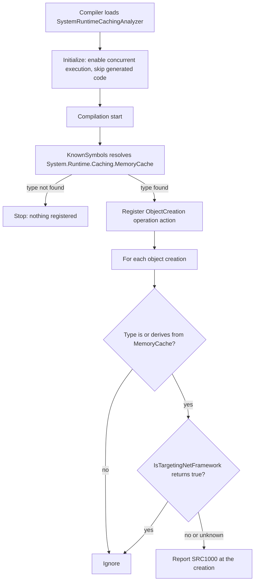
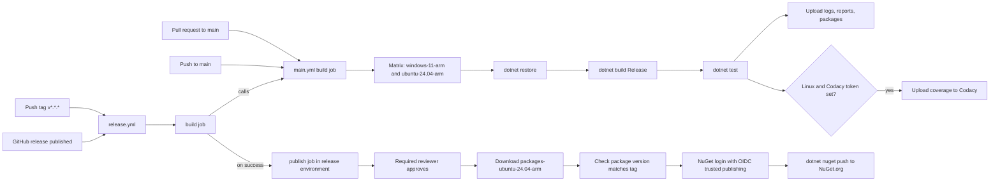

# Architecture

This page shows how the SRC1000 analyzer runs inside the compiler. It also
shows how a code change reaches NuGet.org. The source code and workflow files
are the authority. Update this page when they change.

## Analyzer flow

The analyzer lives in `src/MemoryCache.Analyzers/`. Roslyn loads it into the
C# compiler and the IDE. It runs the steps below.

Notes on the flow:

- `KnownSymbols` looks up the type by its metadata name. The type is missing
  when the project does not reference `System.Runtime.Caching`.
- `ITypeSymbolExtensions.IsOrDerivedFrom` walks the base type chain. It
  compares symbols with `SymbolEqualityComparer.Default`.
- `CompilationExtensions.IsTargetingNetFramework` returns `true` only when
  `System.Object` comes from a .NET Framework `mscorlib`. It returns `null`
  when it cannot tell. The analyzer reports in that case too.
- The rule checks object creation only. It does not report member access such
  as `MemoryCache.Default`, or calls such as `Get` and `Set`. See
  [SRC1000](rules/SRC1000.md).

## Build and release flow

Two GitHub Actions workflows build, test, and publish the package.

Notes on the flow:

- `main.yml` also runs on merge queue groups, on a weekly schedule, on manual
  dispatch, and when `release.yml` calls it.
- The `publish` job only runs after the called `build` job succeeds. It runs
  in the `release` environment, which needs reviewer approval.
- `release.yml` also accepts a manual run. The run must start from a
  `refs/tags/v` ref and must name the expected version.
- The push uses `--skip-duplicate`. A release made with a new tag fires two
  events, and the second run skips the package that is already on NuGet.org.

## Components

| Path | Responsibility |
| --- | --- |
| `src/MemoryCache.Analyzers/` | SRC1000 analyzer, helpers, release tracking |
| `tests/MemoryCache.Analyzers.Tests/` | xUnit analyzer tests, package tests |
| `tests/MemoryCache.Analyzers.Tests/Helpers/` | Verifier and reference sets |
| `build/targets/` | Shared MSBuild props and targets |
| `docs/rules/` | Rule index and one page per rule |
| `.github/workflows/` | CI build and NuGet release workflows |

More detail on each path:

- `src/MemoryCache.Analyzers/` holds `SystemRuntimeCachingAnalyzer`,
  `KnownSymbols`, `CompilationExtensions`, `ITypeSymbolExtensions`, and the
  `AnalyzerReleases` tracking files.
- `tests/MemoryCache.Analyzers.Tests/` holds the analyzer tests and the
  package baseline tests. The package tests compare the built `.nupkg` to
  verified snapshot files.
- `tests/MemoryCache.Analyzers.Tests/Helpers/` holds the analyzer verifier,
  the reference assembly catalog, and test data extensions.
- `build/targets/` holds the artifacts, compiler, reproducible build,
  versioning, tests, and code analysis settings. `Directory.Build.props` and
  `Directory.Build.targets` import them.
- `docs/rules/` holds the diagnostic index and `SRC1000.md`.
- `.github/workflows/` holds `main.yml` and `release.yml`.

## External services

- NuGet.org hosts the published package.
- GitHub Actions runs CI and the release workflow.
- Codacy receives coverage from CI. It also runs static analysis on pull
  requests.
- Renovate opens dependency update pull requests. Its settings live in
  `renovate.json`.

The analyzer itself makes no network calls. It runs inside the compiler and
reads only the compilation it is given.
